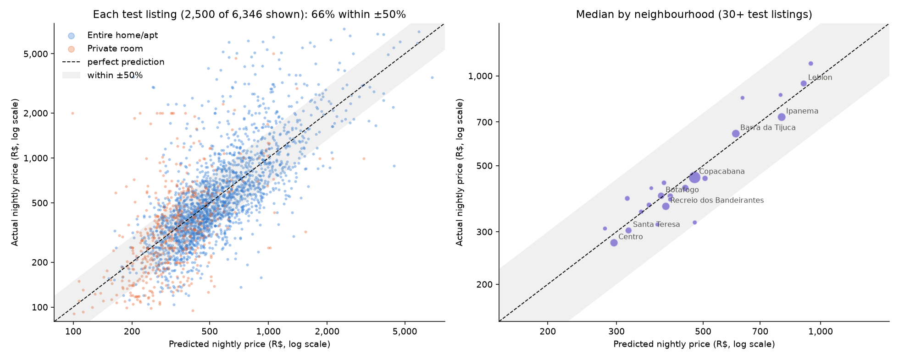
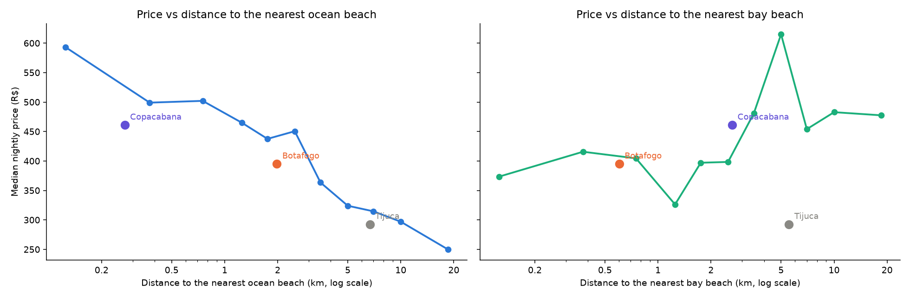

# Airbnb in Rio de Janeiro: regression and classification

A recap of course 1 of the
[Machine Learning Specialization](https://www.coursera.org/specializations/machine-learning-introduction),
which I'm going back through as a refresher.
It asks two questions about **43,192 Airbnb listings in Rio**:

1. **What drives the nightly price?** (linear regression)
2. **Can you tell a business host from someone renting their own place?** (logistic regression)

📓 **[Walkthrough notebook](notebooks/walkthrough.ipynb)**: every step, with the decision made, the code and the chart.

## Results (test set, used once)

| Question | Result | Simple baseline |
|---|---|---|
| **Price** | Explains **54%** of price variation; a typical prediction is off by **45%** (median miss R$123) | Typical price by neighbourhood × room type × bedrooms: 36%, off by 54% |
| **Business host** (3+ listings) | Ranking score (AUC) **0.64**. At a strict cut-off (few false alarms), 2 in 3 flags are right, but only 5% of business listings are caught | Always "not business": 59% accurate |

**The price model** uses curves (degree 2), neighbourhoods and Ridge regularization.

**The business-host finding is honest:** a listing alone barely shows whether its host runs a business.





## What I found

- **The ocean drives price, the bay doesn't.**
  - Each km further from an ocean beach costs about **5%** of the nightly price.
  - Distance to a bay beach (Botafogo, Flamengo, Urca…) adds nothing.
  - Botafogo's premium over areas like Tijuca comes from being about 2 km from Copacabana.
- **Size beats location in a simple lookup.**
  - But distance to the ocean is the single most important feature once everything is in one model.
  - A sea view adds about **21%**; each km from the metro costs about 2%.
- **Coefficients depend on what else is in the model.** An extra bedroom adds **44%** on its own, but about 16% once guests and bathrooms are included.
- **Overfitting is real.** Degree 2 curves help, degree 3 and 4 collapse on new listings, and Ridge pulls them back.
- **Business hosts are hard to spot.**
  - The strongest sign is superhost status.
  - Choosing the cut-off means choosing between false alarms and missed businesses.

## The steps

| Step | Course 1 concept | Decision |
|---|---|---|
| 1. Data | Features, targets, train/validation/test | Log price; business = 3+ listings; ocean *and* bay beaches; split so each host's listings stay together |
| 2. Baselines | Something to beat | Lookups by neighbourhood, by size, and both |
| 3. One feature | Cost function, gradient descent, learning rate | Bedrooms; `SGDRegressor` with three learning rates |
| 4. All features | Multiple regression, feature scaling | Raw vs scaled gradient descent; effects of each feature |
| 5. Flexibility | Polynomial features, overfitting, regularization | 151 neighbourhoods; degrees 1–4; Ridge strength chosen on validation |
| 6. Classification | Logistic regression, decision boundary, threshold | Booking behaviour added; cut-off 0.7, because false alarms are worse |
| 7. Final test | Honest evaluation | The test set is scored once; predictions vs actual prices |

## Data

- **Listings:** [Inside Airbnb](https://insideairbnb.com/), Rio de Janeiro snapshot of 22 September 2026, under
  [CC BY 4.0](https://creativecommons.org/licenses/by/4.0/).
- **Beaches and metro stations:** © [OpenStreetMap](https://www.openstreetmap.org/copyright) contributors, under the
  ODbL, via the Overpass API. 42 metro stations and 72 beaches. I sorted the beaches into ocean and bay by hand; two
  playgrounds tagged as beaches are excluded.
- **What's committed:**
  - `data/rio_listings.csv.gz`: only the modelling columns. Hosts are replaced by anonymous group numbers, with no names, descriptions or profile links.
  - The OpenStreetMap extracts and neighbourhood boundaries.
  - The full listings file is downloaded on demand.

## How to run

```bash
pip install -r requirements.txt
python scripts/run_lesson.py              # all steps: figures/, reports/results.json and reports/charts.json (~1 min)
python scripts/run_lesson.py --download   # re-download the sources and rebuild the data first
pytest                                    # the host-grouped split, no leakage, beach distances, model vs baseline
```

The notebook is generated by `python scripts/build_notebook.py`, then executed with `jupyter nbconvert`.
